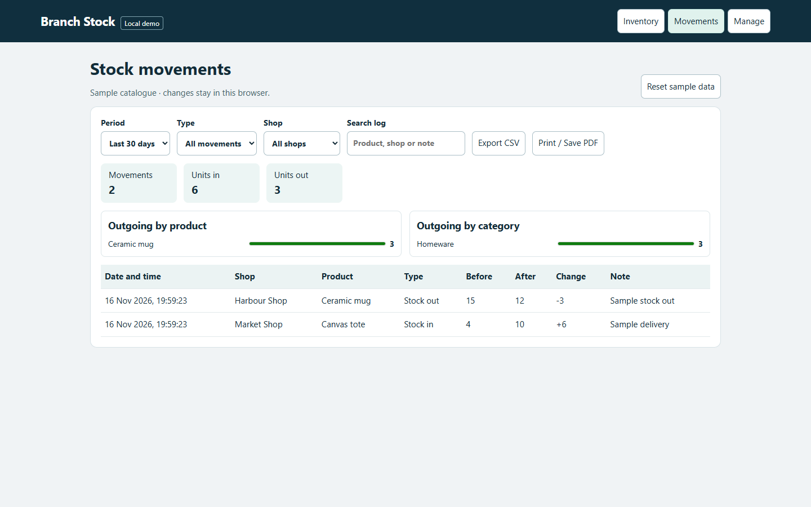

# Branch Stock local demo

This edition follows the inventory and movement workflow from the Vapes Quantity source at revision `e5d5902`. The catalogue is generic and contains fictional products and shops.

## Run on your computer

1. Download the repository ZIP and extract it.
2. Open the `local-demo` folder. Install Node.js if needed.
3. On Windows double-click `Start-Local.cmd`. On any system run `node local-server.cjs` in this folder.
4. Open **http://127.0.0.1:8116/**. Keep the terminal open while using the demo.

**Inventory** shows counts, low stock and expiry dates by shop. Choose **Adjust stock** to record incoming units, outgoing units or a physical count. **Movements** filters the dated log and shows totals and outgoing units by product or category. Export the filtered list as CSV or print it to PDF. **Manage** adds, archives and restores shops and products. Archived entries remain identifiable in movement reports.

Changes stay in local browser storage. Reset returns to the fictional catalogue. This local edition runs without an account, an internet connection or a shared database.

